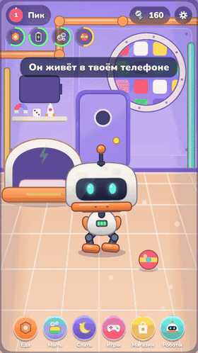

# Робогочи

Детский тамагочи про робота-малыша, который живёт в телефоне. Концепция и играбельный прототип. Toysberry Game Studio, ноябрь 2026.

<p align="center"></p>

- **Играть:** https://funberrytoys-dotcom.github.io/robogochi/play/ (лучше с телефона, на компьютере игра показывается вертикальным «телефоном»)
- **Концепция:** https://funberrytoys-dotcom.github.io/robogochi/ — рынок, 20 роботов, варианты геймплея, развитие, мини-игры, монетизация, план
- **Видео со звуком, около минуты:** https://funberrytoys-dotcom.github.io/robogochi/video/robogochi-demo.mp4
- **APK для Android:** https://github.com/funberrytoys-dotcom/robogochi/releases/latest

## Что умеет прототип

| Жест | Что делает робот |
| --- | --- |
| Провести пальцем по голове | Жмурится, урчит, летят сердечки |
| Тыкнуть 5 раз подряд | Падает, кружится голова, смешно встаёт |
| Постучать по стеклу | Подходит и отвечает клювом тем же ритмом |
| Потянуть за пузико | Поднимается и болтает ножками |
| «Еда» → печеньку к клюву | Хрустит, иногда рыгает |
| «Мыть» → тереть губкой | Пена, хихиканье, душ, отряхивается |
| «Спать» | Идёт в док, спит и заряжается, свет гаснет |
| «Игры» | «Лови винтики», «Пи-пи-повтори», «Танцы», «Мячик» |
| «Магазин» | Шапки (пропеллер умеет летать) и мебель |
| «Роботы» | Коллекция из 20: трое на выбор, девять за игру, восемь в наборах |

Для показа: шестерёнка вверху → «Демо: открыть всех 20 роботов» и «+100 винтиков».

## Что где лежит

| Папка | Что там |
| --- | --- |
| [concept-claude/](concept-claude/) | Страница концепции и арт: постер всех 20 роботов, ключевой 3D-арт, лист Пика с четырёх сторон |
| [tamagotchi/](tamagotchi/) | Игра: исходники, сборка, оболочка для Android. Подробно в [tamagotchi/README.md](tamagotchi/README.md) |
| [research/](research/) | Анализ рынка и похожих игр |
| [docs/](docs/) | Собранный сайт для GitHub Pages: концепция, игра, видео |
| [BRIEF.md](BRIEF.md) | Бриф |

Игра — один HTML-файл без библиотек. Роботы нарисованы кодом и описаны данными, поэтому новый робот — это новая строка в `tamagotchi/src/robots.js`. Все звуки синтезируются в браузере.

## Сборка

```bash
cd tamagotchi
node build.mjs
node tools/pages.mjs
```

`build.mjs` собирает игру в `tamagotchi/dist/`, `tools/pages.mjs` обновляет сайт в `docs/`. Для APK нужен Android SDK: `python tools/build_android.py 0.1.0`. Ключ подписи в репозиторий не входит. Видео записывает `node tools/film.mjs` (нужен `npm install` и ffmpeg): игра проигрывается кадр за кадром вместе со своим звуком.

## Статус

Прототип для показа. Проверено в Chrome в размере телефона и планшета и на эмуляторе Android. На живых телефонах пока не проверялось. Музыка временная, финальные треки будут свои.

© 2026 Toysberry Game Studio. Все права защищены.
